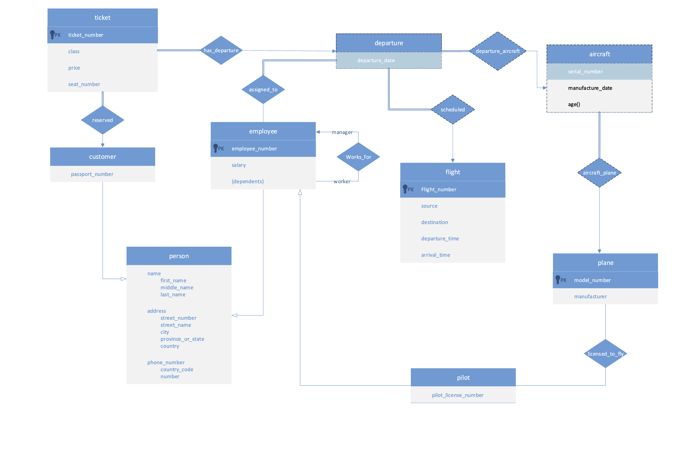

# Airline Database Management System

**Relational Database Design | Microsoft SQL Server | UNBC**

## Overview

A relational database system designed to model airline operations, including flight scheduling, aircraft management, customer reservations, employee assignments, and pilot information.

Developed as a CPSC324 project, it covers the complete database development lifecycle, from conceptual ER modeling and logical schema design to SQL implementation, data population, and business queries.

## Key Features

- **Database Design:** Entity–Relationship (ER) diagram representing airline operations.
- **Relational Schema:** SQL tables with primary keys, foreign keys, composite keys, and integrity constraints.
- **Extended Functionality:** Ticket management and employee–manager relationships.
- **SQL Queries:** Joins, aggregations, Common Table Expressions (CTEs), and multi-stop flight route analysis.
- **Data Validation:** Sample data insertion and queries to verify database relationships.

## Technologies

Microsoft SQL Server · T-SQL · ER Modeling · Relational Database Design

---

[View User Requirements](docs/UserRequirements.md)

